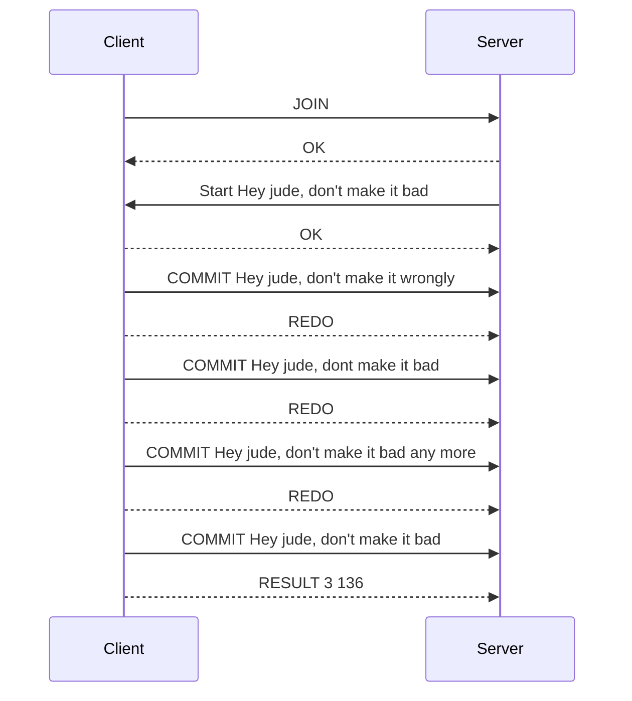

# Application Protocol

Transport Protocol

Port and Encoding

Where a message ends

Every Message and Responses

Errors code and answers

1. Wrong message
2. Wrong moment

 Example  of a communication

Example of a badly made communication


## Description
This application is a speed typing competition between multiple users. Each user, after having asked to join, gets placed in a game lobby automatically generated and managed. When the game starts, the users will be prompted with a text they will have to send back the server. After each game, every connection is broken and the clients will have to ask again to join a game again.

## Communications
### Transport protocol, port and encoding
This game uses TCP and the verification of the inputs are made client side as to not lose any messages and not having to send and reply every time the user types a letter. The server listens on port 1234.

Every message is encoded in UTF-8 and ends with a newline character (\n). A message is therefore one line of text, and cannot contain a newline. Parameters are separated by a single space. Keywords are written in capitals, and are case-sensitive.

The client opens the connection and speaks first, with a `JOIN` message. This will trigger the server to place him in a game lobby already made or make a new one and inform the client that he has been put in a lobby. In case the server cannot create a game lobby because every lobby slots are occupied, it will reply with an error.

The server will then send a `START` message with the text that the user will need to copy.

The client will then reply with a `COMMIT` message and the same text, in case the text is not the same, the server will send a `REDO` message until the client replies with a `COMMIT` with the right text.

After verifying the text, if it is right the server will send a `RESULT` message with the time taken and the position in the game.

At any time after the connection, the client can close the connection to leave.

Three standard errors are possible,`ERROR 1` for an unknown command, `ERROR 2`for a known command with a wrong format or arguments and finally `ERROR 3` for a known command input at the wrong moment.

A specific error is reserved for command specific errors, it is `ERROR 4`.


### Types, format and responses of messages

#### Join a game
##### Request
```
JOIN
```
##### Responses
- `ERROR 2`, "known command, wrong format/arguments, arguments were added"
- `ERROR 3`, "known command, wrong moment, this client is already in a game lobby"
- `ERROR 4`, "the server could not connect the client to a game, all the lobbies are full"
- 'OK', the client joined a game successfully


#### template
##### Request
```
template
```
##### Responses
- `ERROR 1`, unknown command
- `ERROR 2`, known command, wrong format/arguments
- `ERROR 3`, known command, wrong moment


### Global summary of the communication

|Who sends|Type of message|List of arguments|Description|
|:---:|:---:|:---:|:--|
|Client|JOIN|-|Asks to join a game|
|||||
|||||
|||||
|||||
|||||
|||||
|||||
|||||
|||||
|||||
|||||

## Examples
### Correctly made communications

### Wrongly made communications
```mermaid

```

